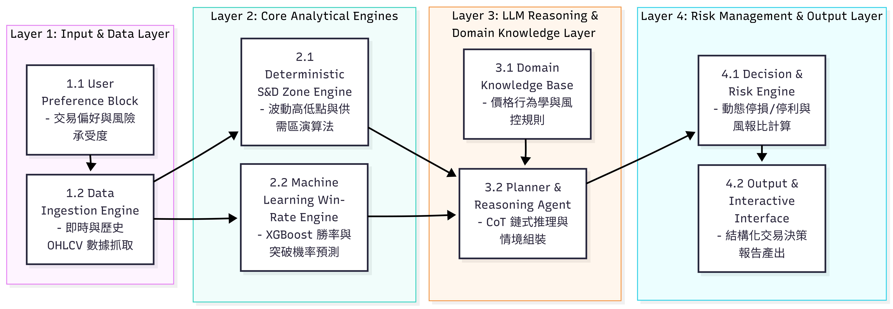
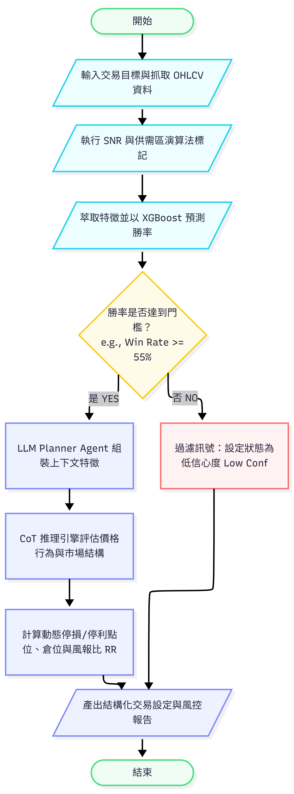

# Hybrid TPA-Agent (Hybrid Technical & Price Action Agent)

> **結合確定性供需區演算法、機器學習勝率預測與 LLM 推理之短線交易智慧代理人系統**
> 
> *A Decoupled Hybrid Intelligent Trading Agent combining Deterministic Spatial Supply & Demand Algorithms, XGBoost Win-Rate Prediction, and LLM Contextual Reasoning with Dynamic Risk Management.*

[](./openspec)
[](https://www.python.org/)
[](https://xgboost.readthedocs.io/)
[](#系統架構-system-architecture)

---

## 📖 專案概述 (Project Overview)

在現代金融市場（特別是加密貨幣與美股日內短線與當沖市場）中，非專業交易員普遍面臨**認知負荷過載、資訊雜訊過多與情緒性決策（FOMO、恐懼、貪婪）**的困境。

傳統量化工具多半僅依賴落後型技術指標（如 MA、RSI），缺乏空間感知能力；純機器學習模型將行情視為扁平時序，容易在盤整期產生假訊號；而新興的純金融大型語言模型（LLM）因缺乏精確數值計算能力，極易產生災難性的「數值與空間幻覺（Hallucination）」。

為了解決上述核心痛點，本專題提出 **Hybrid TPA-Agent**。本系統採用獨創的**四層解耦混合架構**：
1. **100% 確定性 Python 空間演算法**：精確計算 Swing Highs/Lows 與成交量分佈供需區（Supply & Demand Zones），杜絕數值與幾何幻覺；
2. **XGBoost 機器學習勝率引擎**：萃取空間距離與動能特徵，量化突破與反彈的條件勝率；
3. **LLM 推理與價格行為知識庫**：以 Chain-of-Thought (CoT) 鏈式思維檢驗市場結構（S/R Flip, ChoCh, 流動性陷阱）；
4. **動態風控與決策引擎**：嚴格把關數學期望值 $E > 0$、非對稱風報比 $RR \ge 2.0$ 與勝率 $\ge 65\%$，輸出透明可審計的交易決策報告。

---

## 🏛️ 系統架構 (System Architecture)

系統採用嚴格解耦的四層式分塊架構（Tiered Block Architecture），共包含八大核心子模組：



```
[Layer 1: Input & Data Layer (輸入與資料層)]
  ├── [1.1] User Preference Block (交易標的、風險承受度、資金比例)
  └── [1.2] Data Ingestion Engine (即時/歷史 OHLCV 擷取、Volume Profile 計算)
         │
         ▼
[Layer 2: Core Analytical Engines (核心運算引擎層)]
  ├── [2.1] Deterministic Price Action & S&D Zone Engine (Swing 點位、供需區標記)
  └── [2.2] Machine Learning Win-Rate Engine (XGBoost 突破/反彈勝率預測)
         │
         ▼
[Layer 3: LLM Reasoning & Domain Knowledge Layer (推理與知識層)]
  ├── [3.1] Domain Knowledge Base (價格行為學規則庫、S/R 轉換機制、流動性陷阱)
  └── [3.2] Planner & Reasoning Agent (Chain-of-Thought 多步驟情境語意推理)
         │
         ▼
[Layer 4: Risk Management & Output Layer (風控與輸出層)]
  ├── [4.1] Decision & Risk Management Engine (動態停損/停利計算、RR >= 2.0 門檻)
  └── [4.2] Structured Report Interface (結構化 JSON 與 Markdown 交易決策報告)
```

---

## 🔄 核心運作流程 (Execution Workflow)



### 執行序列
1. **行情觸發 (Trigger)**：資料引擎定期抓取目標標的（如 BTCUSDT, ETHUSDT）最新完成之 K 線。
2. **空間幾何分析 (Spatial Analysis)**：確定性演算法計算局部擺動極值，結合 Volume Profile 劃定高成交量供需區塊。
3. **特徵工程與勝率預測 (ML Inference)**：計算價格與鄰近供需區之幾何距離與技術指標特徵，由 XGBoost 評估突破/反彈勝率。
4. **領域語意推理 (CoT Reasoning)**：LLM 載入價格行為學規則庫，審查 K 線形態（如 Pinbar、量能吸收、次級結構改變），過濾流動性誘多/誘空陷阱。
5. **動態風控把關 (Risk Gating)**：動態計算 ATR 緩衝停損位與對向供需區目標價，僅在 $RR \ge 2.0$ 且勝率 $\ge 65\%$ 時核准訊號。
6. **決策報告產出 (Report Synthesis)**：產出機器可讀的 JSON 與交易員友善的 Markdown 報告，支援 Human-in-the-Loop (HITL) 一鍵確認。

---

## ⚡ 核心演算法虛擬碼 (Core Algorithm)

```python
Algorithm: Hybrid Technical & Price Action Agent (Hybrid TPA-Agent)
Input : Asset Symbol S, Timeframe TF, Historical OHLCV D
Output: Actionable Trading Setup & Decision Report R

01: raw_data <- DataAcquisition.fetch_ohlcv(S, TF)
02: demand_zones, supply_zones <- SNR_Engine.detect_zones(raw_data)
03: current_price <- raw_data.close[-1]
04: 
05: features <- FeatureExtractor.extract(raw_data, demand_zones, supply_zones)
06: win_probability <- ML_Engine.predict_win_rate(features)
07: 
08: agent_context <- {current_price, demand_zones, supply_zones, win_probability}
09: evaluated_plan <- PlannerAgent.reason(agent_context, PriceActionKnowledgeBase)
10: 
11: IF evaluated_plan.win_probability >= 0.65 AND evaluated_plan.risk_reward_ratio >= 2.0 THEN
12:     entry_price <- current_price
13:     stop_loss   <- evaluated_plan.recommended_stop_loss
14:     take_profit <- evaluated_plan.recommended_take_profit
15:     R <- SynthesisEngine.generate_report(
16:         Status="APPROVED", 
17:         entry=entry_price, 
18:         stop_loss=stop_loss, 
19:         take_profit=take_profit, 
20:         evidence=evaluated_plan.evidence
21:     )
22: ELSE
23:     R <- SynthesisEngine.generate_report(
24:         Status="WAIT/NO_TRADE", 
25:         reason="Risk-to-Reward (< 2.0) or Win Rate (< 0.65) below threshold."
26:     )
27: END IF
28: return R
```

---

## 📊 資料格式契約 (JSON Data Schemas)

### 1. 供需區結構化輸出 (`zone-detection`)
```json
{
  "symbol": "BTCUSDT",
  "timeframe": "1h",
  "current_price": 62450.0,
  "demand_zones": [
    {
      "zone_id": "DZ-01",
      "price_low": 60800.0,
      "price_high": 61250.0,
      "volume_poc": 61050.0,
      "retest_count": 1,
      "strength": "strong"
    }
  ],
  "supply_zones": [
    {
      "zone_id": "SZ-01",
      "price_low": 64200.0,
      "price_high": 64650.0,
      "volume_poc": 64400.0,
      "retest_count": 0,
      "strength": "moderate"
    }
  ]
}
```

### 2. 最終決策報告 (`report-generation`)
```json
{
  "status": "APPROVED",
  "timestamp": "2026-11-13T21:00:00Z",
  "symbol": "BTCUSDT",
  "action": "LONG",
  "entry_price": 61250.0,
  "stop_loss": 60550.0,
  "take_profit": 64200.0,
  "risk_reward_ratio": 4.21,
  "ml_win_probability": 0.72,
  "reasoning_evidence": [
    "價格回測 1h 強烈需求區 DZ-01，收盤形成帶長下影線之看漲 Pinbar",
    "低時間級別 (15m) 出現結構改變 (ChoCh) 與量能吸收",
    "對向第一道阻力區為 SZ-01 (64200.0)，具備 4.21 倍非對稱風報比"
  ],
  "risk_control": {
    "max_capital_risk_pct": 1.5,
    "position_sizing_units": 0.214
  }
}
```

---

## 📂 專案目錄結構 (Project Structure)

本專案全面導入 **OpenSpec 規範驅動開發 (Spec-Driven Development)** 標準：

```
D:\AIoT_final_project\
├── README.md                                  # 專案總覽與使用說明文件
├── DESIGN.md                                  # 系統設計架構書 (System Design Document)
├── 架構圖.png                                  # 系統 4 層 8 模組架構圖
├── 流程圖flowchart.png                         # 交易決策資料流序列圖
├── Hybrid_TPA_Agent_Final_Project_Proposal.*  # 專案開題提案報告 (PDF/DOCX)
└── openspec/                                  # OpenSpec 規範驅動開發目錄
    ├── config.yaml                            # OpenSpec 總設定檔
    └── changes/
        └── hybrid-tpa-agent/                  # 核心變更節點 (4/4 Complete, Validated)
            ├── .openspec.yaml
            ├── proposal.md                    # 專案動機、變更範圍與 Capabilities
            ├── design.md                      # 技術實作細節、權衡與風險降級
            ├── tasks.md                       # 6 階段 17 項可驗證實作任務清單
            └── specs/                         # 6 大模組標準規格 Delta 文件
                ├── market-data/spec.md
                ├── zone-detection/spec.md
                ├── win-rate-prediction/spec.md
                ├── reasoning-agent/spec.md
                ├── risk-management/spec.md
                └── report-generation/spec.md
```

---

## 🚀 快速開始 (Quick Start)

### 1. 環境需求
- Python 3.10+
- Node.js & OpenSpec CLI (`npm install -g openspec`)

### 2. 安裝相依套件
```bash
pip install pandas numpy scikit-learn xgboost pydantic requests
```

### 3. OpenSpec 規範驗證
本專案已完全通過 OpenSpec 嚴格驗證模式：
```bash
# 檢查工作流狀態
openspec status --change hybrid-tpa-agent

# 執行嚴格格式與規範校驗
openspec validate hybrid-tpa-agent --strict
```

---

## 🛡️ 工程決策與安全降級 (Engineering Safeguards)

| 異常情境 | 觸發條件 | 降級防護策略 |
| :--- | :--- | :--- |
| **API 連線延遲** | 心跳包延遲 $> 2$ 秒 | **Level 1**：立即凍結新訊號產出，維持既有部位。 |
| **在途單保護** | 訂單撮合成交 | **Level 2**：立即於交易所伺服器端掛載硬性停損單 (Stop-Loss OCO)。 |
| **API 斷流** | 網絡連線中斷 $> 30$ 秒 | **Level 3**：觸發本地安全熔斷警報，必要時執行市價強制平倉防護。 |
| **概念漂移 (OOD)** | 市場波動度 $> 3\sigma$ ATR | 暫停 ML 模型推論，自動轉入觀望安全模式（`WAIT/NO_TRADE`）。 |

---

## 📜 授權條款 (License)

本專案採用 [MIT License](LICENSE) 授權。

